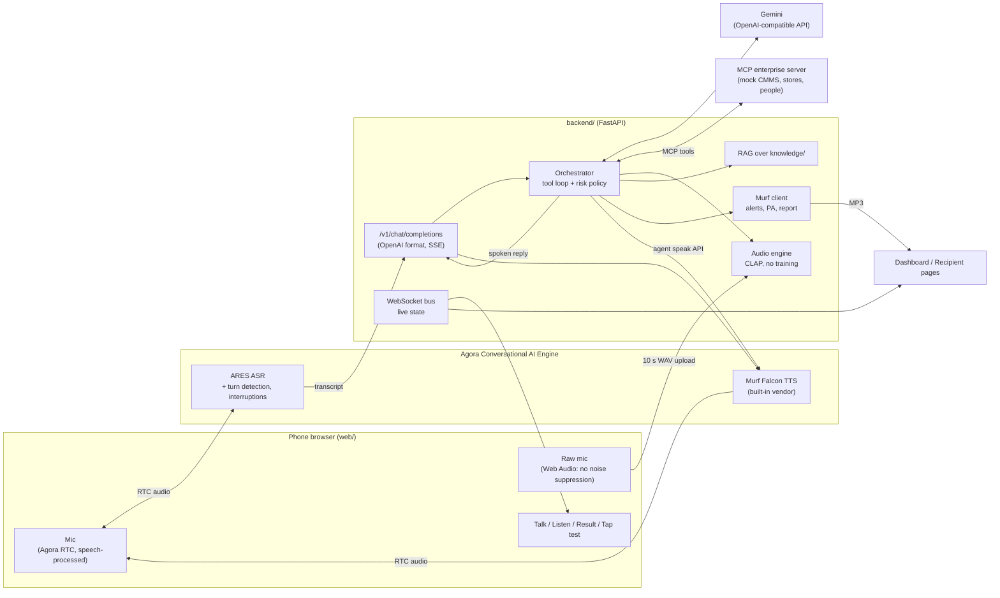

# EarShot

**Hear machine trouble before it becomes a breakdown.**

EarShot is a voice assistant for maintenance and quality workers in any industry. The worker talks to it on their phone. When asked, EarShot **listens to the machine itself** (a running pump, a tapped part, a beeping alarm), compares the sound with that machine's enrolled healthy sound, says what is likely wrong, and then **acts**: raises a work order, checks and reserves spares, takes the asset out of service, briefs the right people in their own language, announces on the floor and writes the spoken shift report. Anything critical waits for a spoken **"yes"**.

Built for **Build with Agora**, track *Voice AI at Work: Beyond the Call Center*.

| Path | What it is | Deploys to |
|---|---|---|
| `backend/` | FastAPI: custom LLM endpoint for Agora, orchestrator and risk policy, CLAP audio engine, RAG, Murf client, live event bus | Railway |
| `mcp_servers/enterprise/` | One MCP server (streamable HTTP) with **mock** enterprise systems: assets, CMMS, stores, notifications, reports; optional Jira Cloud sync | Railway (private) |
| `web/` | Vite + React + TypeScript: website, phone app, projector dashboard, recipient page | Vercel |
| `packs/` | Industry packs (YAML): manufacturing, railways | – |
| `knowledge/` | Enterprise knowledge for RAG: pump manual, LOTO SOP, asset histories, tap-test SOPs, past cases | – |
| `scripts/` | `seed_baselines.py`, `eval_mimii.py`, `dev.sh` | – |

---

## The problem

Experienced technicians diagnose machines by ear: a bearing starting to grind, a wheel that rings dull, an alarm beeping in a pattern only a few people remember. That knowledge is unevenly spread, and acting on it is slow. Someone has to find the history, check stores, raise the job, call the supervisor (often in another language), tell the floor, and write it all up at the end of the shift. Meanwhile the pump keeps running until it seizes.

Example from the seeded data: pump P-07 made a grinding sound for a week in March. Nobody acted. The bearing seized on night shift and Line 3 was down 7.5 hours. A planned bearing change takes about 2 hours.

EarShot gives every worker the senior technician's ear and does the paperwork and phone calls while they're still standing at the machine.

---

## Architecture



There are **two audio paths**, side by side:

- **Voice path:** browser ⇄ Agora RTC ⇄ Agora Conversational AI agent (ASR, turn detection, interruptions). The agent calls our backend as a **custom LLM**. Our orchestrator runs the tool loop and returns only the spoken text, and Agora speaks it with **Murf Falcon**.
- **Sound path:** Agora's speech pipeline uses noise suppression, which would remove the machine sound, and ASR only produces words. So machine audio does **not** go through Agora. In Listen mode the browser **mutes the Agora mic track**, captures raw audio with Web Audio (`noiseSuppression`, `echoCancellation` and `autoGainControl` all off), records 10 s between two beeps, and uploads a WAV. The verdict becomes the result of the `analyze_sound` tool.

Every tool call and state change is pushed over a **WebSocket event bus** to the dashboard and the phone. The live transcript also comes from this bus, because the backend sees every turn in both directions.

---

## Agora integration

Everything below was taken from Agora's **official SDKs**: Python `agora-agents` 2.15 (server) and `agora-rtc-sdk-ng` 4.24 (web). Field names come from the SDK sources, not from guesses.

| What | How |
|---|---|
| **Tokens** | `POST /api/session` creates a channel and an AccessToken2 for the browser with `agora_agent.generate_client_token`. The agent's token and the REST auth are generated by the SDK from the **App ID + App Certificate**, so no Customer ID/Secret is needed. |
| **Start the agent** | `backend/agora/convoai.py` builds an `agora_agent.agentkit.Agent`. It sends `POST /api/conversational-ai-agent/v2/projects/{appid}/join`, with `agent_rtc_uid`, `remote_rtc_uids`, `idle_timeout: 120`, ASR `{"vendor": "ares", "language": "en-IN"}` (Hindi `hi-IN` and Tamil `ta-IN` are supported) and `interruption: {"enable": true, "mode": "start_of_speech"}`. |
| **LLM** | `CustomLLM` → `llm: {"vendor": "custom", "style": "openai", "url": "${PUBLIC_BACKEND_URL}/v1/chat/completions?session=<channel>", "api_key": AGENT_LLM_KEY, "headers": {"X-EarShot-Session": channel}, "greeting_message": …}`. Our endpoint checks the Bearer key, keys the conversation by channel, runs the orchestrator and streams OpenAI `chat.completion.chunk` SSE. Tool calls are resolved inside the orchestrator and never returned to Agora. |
| **TTS** | **Murf is a built-in Agora TTS vendor**: `tts: {"vendor": "murf", "params": {"api_key", "voiceId", "locale", "model": "falcon-2.1"}}`. **No TTS adapter was needed**, so there is no `tts_adapter.py`. |
| **Speaking outside a user turn** | After a clip is analysed, the orchestrator composes the result and calls the agent **speak** API (`POST …/agents/{agent_id}/speak`, via `AsyncAgentSession.say`, priority `INTERRUPT`). If the agent has already left (idle timeout), EarShot falls back to Murf audio played in the browser. Either way the turn is appended to the session history. |
| **Stop** | `DELETE /api/session/{id}` → `…/agents/{agent_id}/leave`. All agents are stopped on backend shutdown. |
| **Web** | `web/src/lib/agora.ts` joins with `agora-rtc-sdk-ng`, publishes the mic (AEC/ANS/AGC on for speech), plays the agent, and drives the orb from the agent's real volume level. |

> Agora RTM / the agent client toolkit are **not** required: transcripts and state come from EarShot's own WebSocket.
> The stretch goal "alerts as real Agora calls to recipients" is **not** implemented. Recipients get the documented fallback: a Murf voice briefing on the recipient page with Approve / Decline buttons.

---

## Murf integration

Murf Falcon is used twice:

1. **As the agent's voice**, through Agora's built-in Murf vendor (above).
2. **Directly from our backend** (`backend/murf.py`): `POST {MURF_REGION_URL}/v1/speech/stream` with `voice_id`, `text`, `locale`, `model: "falcon-2.1"`, `format: "MP3"`, `sampleRate: 24000`, `channelType: "MONO"`, streamed to a file. It is used for:
   - **Multilingual alert briefings.** `notify_people` → Gemini writes the briefing in the person's language (English, Hindi, Tamil) → Murf voices it → it appears on `/recipient?name=…` and in "People EarShot is contacting".
   - **Floor announcements.** `announce_on_floor` → Murf → played on the dashboard.
   - **The spoken shift report.** `generate_report` or the dashboard button → Gemini writes it from the shift timeline → Murf → shift briefing player, with "Read it instead".
   - **Second-approver requests** (tier 3), and **results when no call is active** (Listen / Tap / Add a machine pages).

**Voices** are picked from Murf's own voice list (`GET https://api.murf.ai/v1/speech/voices`), never hard-coded. EarShot takes native voices for the locale first, then voices that support it, and caches the choice. Different roles get different voices: agent, briefings, announcements.

**Latency is measured on every call**, as time to first audio chunk and total time. `GET /api/metrics/tts` reports the medians. The dashboard shows **"Voice reply in X s" = measured LLM reply time + measured Murf first-audio time**, and the tooltip shows both parts.

---

## The agentic workflow: Initiate → Understand → Execute → Confirm → Follow up

1. **Initiate.** The worker says *"EarShot, check pump P-14"*, or taps the orange Listen button.
2. **Understand.**
   - The LLM (Gemini via its OpenAI-compatible API) calls `identify_asset`, then `start_listening`. That emits `capture_start`, and the phone opens the Listen screen: it mutes Agora, beeps, records 10 s with a countdown and level meter, beeps again and uploads.
   - The audio engine scores the clip, and the orchestrator runs a turn from a system note ("sound analysis ready").
   - The LLM calls `analyze_sound`, `get_asset_history`, `find_similar_cases` (sound case library + matching past work orders + RAG), `assess_risk` and `check_inventory`. Then it says what it heard, why, what it recommends and what it will do if the worker says yes.
3. **Execute (under the risk policy).** `backend/policy.py` and the orchestrator enforce tiers from the pack:
   - **Tier 0**, runs silently: lookups, scoring, logging.
   - **Tier 1**, runs and is then mentioned: reserve a part, notify people, announce.
   - **Tier 2**, needs a yes: stop-work order, take out of service, hold a batch. If the LLM calls one without approval, the tool returns `needs_confirmation` and opens a confirmation; the LLM must ask.
   - **Tier 3**, also needs a second approver: shut down a line, purchase above the limit. The approver is briefed in their language and answers on the recipient page.
4. **Confirm.** A spoken *"yes"* (or *haan*, *sari*, …) is recognised **deterministically by the backend**, not by the LLM, and approves the pending plan for that session. Taps on the phone's confirm sheet or the dashboard's "Needs your attention" banner do the same. Approval grants exactly the listed tools, for 10 minutes.
5. **Follow up.** The work order is raised, the part reserved, P-14 turns red on the twin, Suresh (Hindi) and Kavya (Tamil) are briefed with Murf voice messages, the floor hears the announcement, and replies flow back ("Kavya replied: no stock"). EarShot tells the worker, and the shift report is written and read aloud.

**After the yes: tracked plans and closing the loop.**
- **Plan steps:** every promised step ("Raise the repair job", "Call Suresh and Kavya", …) is tied to the tool that does it. On the timeline each step becomes **done** (with what actually happened, e.g. "Raised repair job WO-2401 · Jira EAR-12"), **failed**, or **not done** if the turn ended without it.
- **Job stages:** jobs move through *scheduled → in progress → done* (`update_work_order`, or *Start job* on the phone).
- **Mark done re-listens before closing:**
  - It records the machine again after the repair.
  - If it sounds normal, EarShot closes the job (and the Jira issue), puts the machine back in service, and saves the original recording to the case library under the confirmed cause, so the next diagnosis improves.
  - If it still sounds unusual, the job stays open.
- **Reminders:**
  - "Not now", slightly unusual machines and the `schedule_follow_up` tool create reminders for the next shift.
  - They appear on the dashboard ("Coming up next shift"), on the phone and in the spoken shift report, and are cleared when the machine is checked again.

**Error handling (all demoable):**

| Case | What EarShot does |
|---|---|
| Spare out of stock | `check_inventory` shows stock per warehouse (e.g. mechanical seal: 0 in Main stores, 3 in Warehouse B). EarShot offers the other warehouse or a purchase request; above the limit, that is tier 3. |
| Unclear clip | Too quiet, too short or clipped clips are rejected with a placement tip ("move the phone closer, about a hand's width from where it sounds loudest"), and EarShot asks for a re-record. |
| Low confidence | When the label is "not sure", EarShot says so and offers to call a person. |
| Tool failure | Each MCP call is retried once, then explained in plain words. Demo it with `POST /api/debug/fail-next {"tool": "check_inventory"}`. |
| Machine not set up | EarShot offers to record its healthy sound now. |

---

## The audio engine (no training)

`backend/audio/` uses **LAION CLAP** (`laion/clap-htsat-unfused`, via Hugging Face `transformers`), loaded once at startup in the background. All audio is resampled to 48 kHz mono.

- **Enroll:** about 10 s of healthy sound → 1 s windows with 50 % overlap → L2-normalised CLAP embeddings → mean vector, plus the spread of each window's cosine distance to the mean. The spread has a floor (≥ half the mean distance), so that small changes in room or phone position don't look like faults.
- **Score:** the median window distance to the baseline mean, z-scored against enrollment, then a logistic → shown as `normal` (< 0.4) / `slightly unusual` / `very unusual` (> 0.7). Thresholds are per pack. Workers never see the number.
- **Label:** zero-shot CLAP against "the sound of a {type} with {fault}" prompts from the pack's `fault_vocab`, blended with nearest-neighbour votes from the labeled case library (`record_feedback`). It gives a confidence word plus two alternatives, and is always phrased as a suggestion.
- **Tap mode:** librosa onsets → per-tap ring decay (time to −20 dB) and embedding distance vs an enrolled good tap → `good` / `dull`, in order, with the ring envelope for the "good vs this" picture.
- **Alarm mode:** beep durations → pattern (`L L S`) → pack `alarm_codes`.
- **Spectrum:** 24 log-spaced bands, 50 Hz–16 kHz, for "healthy vs now".

**Measuring it:** `scripts/eval_mimii.py` reports ROC-AUC per machine type and id for 10 s, 1 min and 5 min baselines on the MIMII dataset, writing `results/mimii_auc.csv` and `results/mimii_auc.png`. No numbers are quoted here: run it on your copy of MIMII.

---

## Industry packs

`packs/*.yaml` hold, per industry:
- assets and their listening modes, `fault_vocab` per asset type, the repair part for each fault
- `alarm_codes`
- site vocabulary (railways: *"mark the coach sick"*, *"repair memo"*)
- policy tiers per tool and the purchase limit
- people, with roles, languages and approvers
- the knowledge files used for RAG
- the estimated hours saved per early catch (shown as **estimated** on the dashboard)

Switching the industry in the dashboard reloads the twin, resets the mock enterprise data for that pack, rebuilds the knowledge index, and tells live callers. The agent's prompt is rebuilt from the active pack on every turn.

**Optional Jira Cloud sync:**
- **Turn it on:** set `JIRA_SITE`, `JIRA_EMAIL`, `JIRA_API_TOKEN` and `JIRA_PROJECT` (read by the MCP server). If any is missing, Jira is simply off and nothing else changes.
- **Check the connection:** restart the MCP service after setting its variables, then open **Jira setup** on the dashboard and select **Test connection**. The check verifies the account has Create Issues permission and creates no ticket. Set `JIRA_ISSUE_TYPE` if your project uses a type other than `Task`.
- **New jobs:** every new approved repair job is also created as a Jira issue (REST API v3) with:
  - summary `P-14: <title>` and the priority mapped across
  - labels `earshot` and the asset id
  - a description with what EarShot heard, how sure it is, the similar case, a link to the recording, the schedule and who approved it
- **Stage changes:** each stage change adds a comment and moves the issue to the matching status category (To Do / In Progress / Done), so it works with any workflow's status names.
- **Where the key shows:** on the phone's jobs page, the dashboard timeline ("Open in Jira") and the shift report.
- **If Jira fails:** the job is still saved in the mock maintenance system, and Jira errors never fail a tool.

**Mock data notice:** the enterprise systems (assets, CMMS work orders, inventory, notifications, reports) in `mcp_servers/enterprise/data.json` are **mock data for the demo**. Asset histories and past cases in `knowledge/` are realistic but fictional.

---

## How to run

### Accounts and keys
- **Agora** ([console.agora.io](https://console.agora.io)): a project with the App Certificate enabled and **Conversational AI** activated. You need the App ID and App Certificate.
- **Gemini** ([aistudio.google.com](https://aistudio.google.com)): an API key. Check that your model (default `gemini-3.8-flash`) is listed for your key.
- **Murf** (murf.ai, API): an API key with Falcon access.

### Local (macOS / Linux)
Needs Python 3.12+, Node 20+ and cloudflared (or ngrok).

```bash
cp .env.example .env          # fill in the keys (no quotes needed)
```
```bash
cd backend && python3 -m venv .venv && .venv/bin/pip install -r requirements.txt
```
```bash
cd web && npm install
```

Agora's cloud must reach your backend over HTTPS. Start a tunnel and put its URL in `.env` as `PUBLIC_BACKEND_URL`:
```bash
cloudflared tunnel --url http://127.0.0.1:8000      # or: ngrok http 8000
```

Then start everything (MCP server :8101, backend :8000, web :5173):
```bash
./scripts/dev.sh
```
Or use three terminals: `python server.py` in `mcp_servers/enterprise`, `.venv/bin/uvicorn main:app --reload --port 8000` in `backend`, and `npm run dev` in `web`.

The first backend start downloads the CLAP model (~600 MB). `GET /api/health` shows `"sound_engine": "ready"` when it's done.

Open:
- `http://localhost:5173/app`: phone app (for the mic on a real phone, use https: a second tunnel to :5173, or Vercel)
- `http://localhost:5173/dashboard`: projector dashboard
- `http://localhost:5173/recipient?name=Suresh`: supervisor's phone

**`DEMO_MODE=true`** runs without Agora: the Talk page becomes a text box, replies are voiced with Murf if a key is set, and the sound path works the same. Only `LLM_API_KEY` is required.

**Docker:** `docker compose up --build` runs all three. You still need a tunnel for Agora.

### Seed demo baselines from MIMII (optional)
Download MIMII from Zenodo into `data/mimii/`, then:
```bash
backend/.venv/bin/python scripts/seed_baselines.py --mimii data/mimii
```
This enrolls P-11…P-14 (pump ids 00/02/04/06) and CP-2 (fan id 00; MIMII has no compressor), adds labeled pump cases, and exports `data/demo/P-14_normal.wav` and `P-14_abnormal.wav` to play from a second phone.

Evaluate the method on MIMII:
```bash
backend/.venv/bin/pip install -r scripts/requirements.txt
```
```bash
backend/.venv/bin/python scripts/eval_mimii.py --mimii data/mimii --max-test 50
```

> For the live demo, **enroll through the same speaker you'll play the faulty clip from** (app → Add a machine → *Enroll from this speaker*). Phone recordings and MIMII's 16 kHz clips differ, and speaker colouring would otherwise look like a fault.

### Deploy: Railway (backend + MCP) and Vercel (web)
1. **MCP server** (Railway service 1):
   - Root directory `mcp_servers/enterprise`. It builds its Dockerfile.
   - Variables: `PORT=8101` and `HOST=::` (Railway's private network uses IPv6), plus the optional `JIRA_*` settings.
   - **Don't** generate a public domain; it is reached over Railway's private network.
2. **Backend** (Railway service 2):
   - Root directory `/` (repo root), config file path `/backend/railway.json` (it builds `backend/Dockerfile`).
   - Generate a domain.
   - Attach a **volume at `/app/backend/store`** so baselines survive deploys.
   - Variables: everything in `.env.example`, plus:
     - `PUBLIC_BACKEND_URL=https://<backend-domain>`
     - `MCP_ENTERPRISE_URL=http://<mcp-service>.railway.internal:8101/mcp`
     - `CORS_ORIGINS=https://<your-app>.vercel.app`
     - a fixed `AGENT_LLM_KEY`
   - CLAP needs about 2 GB of RAM. Use one replica: sessions are in memory.
3. **Web** (Vercel): root directory `web`, with `VITE_BACKEND_URL=https://<backend-domain>`. `web/vercel.json` handles routing.

---

## Demo script

1. **Factory.**
   1. *"EarShot, check pump P-14."* The Listen screen opens. Play the faulty pump clip from a second phone.
   2. EarShot gives the diagnosis ("sounds like a worn bearing, like P-7 in March"), the evidence and the cost trade-off, then asks *"Stop P-14 at 10 PM and fix it?"*
   3. Say *"Yes."* The work order is raised, the bearing reserved, and P-14 turns red.
   4. Suresh is briefed in Hindi and Kavya in Tamil (open `/recipient?name=Kavya` on another phone), and the floor announcement plays on the dashboard.
2. **Railways.**
   1. Switch Industry → Railways on the dashboard.
   2. Tap test with two steel cups: record the good one as the reference, then tap the parts. You get *"Part 4 sounds dull"*. Tap it again.
   3. EarShot asks to mark the coach sick. After a yes, the coach is out of service and train control is briefed.
3. **Judge's turn.**
   1. App → Add a machine (or *"EarShot, add a new machine"*). Record any object's healthy sound.
   2. Make it sound wrong. It is flagged, and after a yes a ticket is opened.
4. **End.** Dashboard → *Write the shift report*, then play it. Show the shift tiles and the measured voice latency.

---

## Configuration

See `.env.example`. Secrets stay in `.env`, which is never committed and never logged. The config is validated at startup: missing settings are listed by name in the log and at `/api/health`. Key settings:
- `LLM_BASE_URL`, `LLM_MODEL`, `LLM_REASONING_EFFORT`: any OpenAI-compatible provider; defaults to Gemini.
- `MURF_MODEL` (`falcon-2.1`), `MURF_REGION_URL`, `MURF_AGENT_VOICE` (optional pin).
- `DEFAULT_PACK`, `STORE_DIR`, `DEMO_MODE`.
